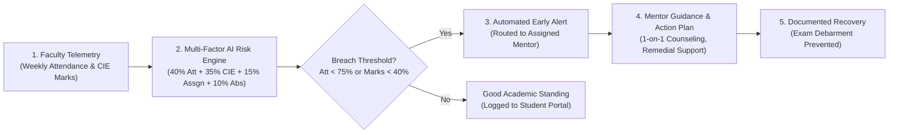

# 🎓 Student Early Alert & Retention System (SEAS)
> **Enterprise-Grade Full Stack MERN Platform for Higher Education Student Success, Automated Academic Telemetry & Proactive Faculty Mentorship**  
> *Developed for College Department Deployment & Portfolio Showcase*

[](https://nodejs.org/)
[](https://expressjs.com/)
[](https://www.mongodb.com/)
[](LICENSE)
[]()

---

## 📌 Executive Summary & Real-Life College Workflow

In higher education institutions, thousands of students face **semester exam debarment** or **academic failure** every year simply because warning signs (attendance deficits, failing internal exams, missing continuous evaluation assignments) are detected too late—often only a week before final university exams.

The **Student Early Alert & Retention System (SEAS)** solves this crisis by introducing a continuous, closed-loop telemetry and guidance platform between **Students**, **Faculty Mentors**, and **College Administration**:



### 🎯 How It Works in Real Life:
1. **Student Account & Automated Faculty Allocation**:
   - When a student signs up with their department and semester (e.g. Computer Science, Semester 4), SEAS **automatically pairs the student with an active Faculty Mentor** from that department.
   - An onboarding guidance intervention is immediately generated so the student knows their mentor's name, email, department, and office hours.
2. **Student Self-Service Portal**:
   - The student accesses their personalized dashboard showing their assigned mentor, real-time risk index (0–100), overall attendance against the mandatory 75% floor, continuous internal marks, and enrolled courses.
   - **Direct Student-Faculty Communication**: The student can submit a **"Request Faculty Guidance"** form directly from their portal to seek assistance with difficult subjects, attendance shortages, or personal wellness.
3. **Faculty / Teacher Workstation**:
   - Faculty members log in to view their assigned mentee caseload, enter/update attendance and internal test marks, review urgent guidance requests sent by students, log counseling notes, and set recovery milestones with scheduled follow-ups.
4. **Institutional Governance & Compliance**:
   - Administrators oversee campus-wide analytics, manage departments, classes, and warning thresholds.
   - **Mandatory Compliance Rule**: Academic records cannot be altered by administrators without entering an explicit justification, which is permanently logged in the immutable **Audit Trail**.

---

## 🏛️ System Architecture & Role-Based Access Control (RBAC)

The system implements zero-trust role segregation:

| Persona | Primary Responsibilities | Access Restrictions |
| :--- | :--- | :--- |
| **🛡️ Administrator** | Campus KPI analytics, faculty account provisioning, department/subject mappings, warning thresholds, audit trail inspection. | Cannot alter academic records without mandatory audit justification. |
| **👨‍🏫 Faculty / Mentor** | Cohort telemetry entry (attendance, CIE marks), review alerts for assigned mentees, schedule 1-on-1 guidance, conduct remedial sessions. | Strictly restricted to assigned student cohort and courses taught. |
| **🎓 Student** | View personal academic standing, monitor exam eligibility, view mentor guidance history & action items, request mentorship appointments. | **Zero Peer Leakage**: Cannot view other students' records or access faculty/admin endpoints. |

---

## 🧮 Multi-Factor Early Warning Risk Engine

The composite risk algorithm is calculated continuously on telemetry sync:

$$\text{Composite Risk Index} = (0.40 \times P_{\text{attendance}}) + (0.35 \times P_{\text{academics}}) + (0.15 \times P_{\text{assignments}}) + (0.10 \times P_{\text{absences}})$$

- **$P_{\text{attendance}}$ (40% Weight)**: Applies an exponential penalty if attendance drops below the 75% university benchmark or the 65% critical debarment threshold.
- **$P_{\text{academics}}$ (35% Weight)**: Evaluates continuous internal exam (CIE) percentages against institutional passing floors (40%).
- **$P_{\text{assignments}}$ (15% Weight)**: Tracks continuous evaluation assignment backlogs.
- **$P_{\text{absences}}$ (10% Weight)**: Flags consecutive unexcused absent days that signal disengagement.

### Categorical Risk Stratification:
- 🔴 **CRITICAL RISK (Score $\ge$ 60 or Attendance $<$ 65% or Internals $<$ 40%)**: Immediate intervention alert dispatched to assigned mentor; high risk of university exam debarment.
- 🟡 **MODERATE RISK (Score 35–59 or Attendance $<$ 75%)**: Advisory notice dispatched; study support recommended.
- 🟢 **SAFE STANDING (Score $<$ 35)**: Satisfies all university exam eligibility benchmarks.

---

## 🛠️ Technology Stack

- **Backend Runtime**: Node.js (CommonJS, v20+)
- **Application Framework**: Express.js 4.x
- **Database**: MongoDB (Local instance & MongoDB Atlas Cloud)
- **Object Data Modeling**: Mongoose 8.x with schema validation & virtuals
- **Security & Auth**: JSON Web Tokens (JWT), Bcrypt.js (10 salt rounds), CORS
- **Frontend Dashboard**: Responsive Single-Page Application (HTML5, Tailwind CSS, Vanilla JS, Chart.js)
- **Testing & Verification**: Built-in automated integration test harness (`npm test`)

---

## 📂 Project Directory Structure

```text
student-early-alert-system/
├── backend/
│   ├── config/
│   │   └── db.js                 # Resilient MongoDB connection (Local & Atlas Cloud)
│   ├── controllers/
│   │   ├── adminController.js    # Executive analytics, teachers, thresholds, audit
│   │   ├── alertController.js    # System alerts feed with role isolation
│   │   ├── analyticsController.js# Campus summary statistics
│   │   ├── authController.js     # Secure JWT auth, student-mentor auto-pairing
│   │   ├── interventionController.js # Guidance sessions & follow-ups
│   │   ├── studentController.js  # Student CRUD, metrics sync, guidance requests
│   │   └── teacherController.js  # Faculty workstation, caseload, gradebook
│   ├── middleware/
│   │   ├── authMiddleware.js     # JWT verification & role authorization
│   │   └── errorMiddleware.js    # Centralized error handler
│   ├── models/
│   │   ├── AcademicRecord.js     # Internal examination scores & assignments
│   │   ├── Alert.js              # Triggered warning alerts & severity
│   │   ├── Attendance.js         # Course-wise class attendance
│   │   ├── AuditLog.js           # Immutable administrative audit log
│   │   ├── ClassRoom.js          # Sections & semesters
│   │   ├── Department.js         # Academic departments (CSE, IT, ECE)
│   │   ├── Intervention.js       # Guidance sessions, discussion notes, action items
│   │   ├── Student.js            # Student profile, calculated risk score & status
│   │   ├── Subject.js            # Subjects mapped to faculty
│   │   ├── ThresholdConfig.js    # Dynamic campus warning thresholds
│   │   └── User.js               # Admin, faculty, advisor, student accounts
│   ├── routes/                   # Modular Express routers
│   └── utils/
│       └── riskEngine.js         # Multi-factor mathematical risk engine
├── public/                       # Production frontend dashboard (served by server.js)
│   ├── css/
│   ├── js/
│   │   ├── api.js                # Dynamic REST client with cloud auto-detect
│   │   ├── app.js                # Role UI rendering & guidance interactions
│   │   └── charts.js             # Risk distribution & trend charts
│   └── index.html                # Responsive single-page application dashboard
├── scripts/
│   ├── seed.js                   # Comprehensive database seeder
│   ├── run-verify.js             # Automated server boot & test runner
│   └── test-system.js            # Security & workflow integration tests
├── .env.example                  # Environment template (Local & Atlas)
├── .gitignore                    # Production git ignores
├── package.json                  # Scripts & dependencies
├── server.js                     # Main unified production entrypoint
└── README.md                     # Documentation
```

---

## ⚡ Quick Start Guide (Local Development)

### 1. Prerequisites
- **Node.js** v18+ installed
- **MongoDB** running locally on port 27017 or a **MongoDB Atlas** connection string

### 2. Installation
```powershell
# Navigate to project directory
cd D:\projects\student-early-alert-system

# Install dependencies
npm install
```

### 3. Configure Environment Variables
Copy `.env.example` to `.env`:
```powershell
copy .env.example .env
```
Default `.env` configuration:
```env
PORT=5000
MONGODB_URI=mongodb://127.0.0.1:27017/student_early_alert
JWT_SECRET=early_alert_jwt_secret_key_fsd2_2026_production_secure_token
NODE_ENV=development
```

### 4. Seed Database with Institutional Personas
```powershell
npm run seed
```
This populates sample departments, faculty accounts, classes, threshold rules, and student cohorts.

### 5. Run the Automated Verification Test Suite
```powershell
npm test
```
Verifies student registration, automatic mentor allocation, admin route isolation, peer privacy protection, and guidance request routing.

### 6. Start the Application
```powershell
npm start
```
Open your browser at:  
👉 **`http://localhost:5000`**

---

## 🚀 Cloud Deployment Guide (Free & Production Ready)

The application is architected as a **unified full-stack service** (`server.js` serves both the Express REST API and the SPA frontend from `/public`), which means it can be deployed in a single click on platforms like **Render**, **Railway**, or **AWS**.

### Option 1: Deploy on Render.com (Recommended)
1. Push your repository to **GitHub**.
2. Log into [Render.com](https://render.com/) and create a new **Web Service**.
3. Connect your GitHub repository.
4. Configure service settings:
   - **Environment**: `Node`
   - **Build Command**: `npm install`
   - **Start Command**: `npm start`
5. In **Environment Variables**, add:
   - `NODE_ENV` = `production`
   - `JWT_SECRET` = `<your-secure-random-string>`
   - `MONGODB_URI` = `mongodb+srv://<user>:<password>@cluster0.mongodb.net/student_early_alert?retryWrites=true&w=majority`
6. Click **Deploy Web Service**! Once deployed, seed your cloud database by running `node scripts/seed.js` via the Render Shell.

### Option 2: Deploy on Railway.app
1. Create a project in [Railway.app](https://railway.app/).
2. Select **Deploy from GitHub repo**.
3. Add MongoDB Plugin or provide your MongoDB Atlas URI in environment variables.
4. Railway will automatically detect `package.json` and start via `npm start`.

---

## 🧪 Pre-Configured Test Credentials

| Persona | Email | Password | Primary Interface |
| :--- | :--- | :--- | :--- |
| **🛡️ Administrator** | `admin@college.edu` | `Password@123` | Institutional Analytics, Audit Logs, Warning Thresholds |
| **👨‍🏫 Faculty / Mentor** | `faculty@college.edu` | `Password@123` | Mentee Caseload, Gradebook, Guidance Notes |
| **👩‍💼 Academic Advisor** | `advisor@college.edu` | `Password@123` | Counseling Studio, Risk Review |
| **🎓 Seeded Student** | `rahul.sharma@student.edu` | `Password@123` | Student Portal, Mentor Info, Attendance Tracker |

*(Note: In production, demo accounts can be replaced or passwords updated via the Admin panel).*

---

## 💼 Resume & Interview Talking Points (Maximizing Portfolio Weightage)

When presenting this project to interviewers or your Head of Department (HOD), highlight these specific software engineering achievements:

1. **Role-Based Zero-Trust Architecture**:
   - Designed strict middleware authorization boundaries preventing horizontal privilege escalation (students cannot view peers' academic metrics) and vertical escalation (students cannot access administrative routes or self-register as admin).
2. **Deterministic Mathematical Risk Modeling**:
   - Engineered a 4-factor continuous telemetry model combining attendance floor penalties, continuous evaluation averages, missing assignments, and consecutive absences into a single actionable index.
3. **Mandatory Institutional Audit Trail**:
   - Implemented an immutable compliance log where administrative overrides of student grades/attendance are rejected unless accompanied by an explicit, signed justification.
4. **Automated Closed-Loop Mentorship**:
   - Automated the entire retention lifecycle: student signup $\rightarrow$ algorithmic faculty mentor matching $\rightarrow$ early warning trigger $\rightarrow$ student guidance request $\rightarrow$ documented recovery outcome.
5. **Production Single-Origin Architecture**:
   - Optimized deployment complexity by unifying client-side SPA routing and backend REST services under one Express process, with adaptive cloud API URL resolution.

---

## 📄 License

This project is licensed under the ISC License. Built with ❤️ for educational excellence and student retention.
